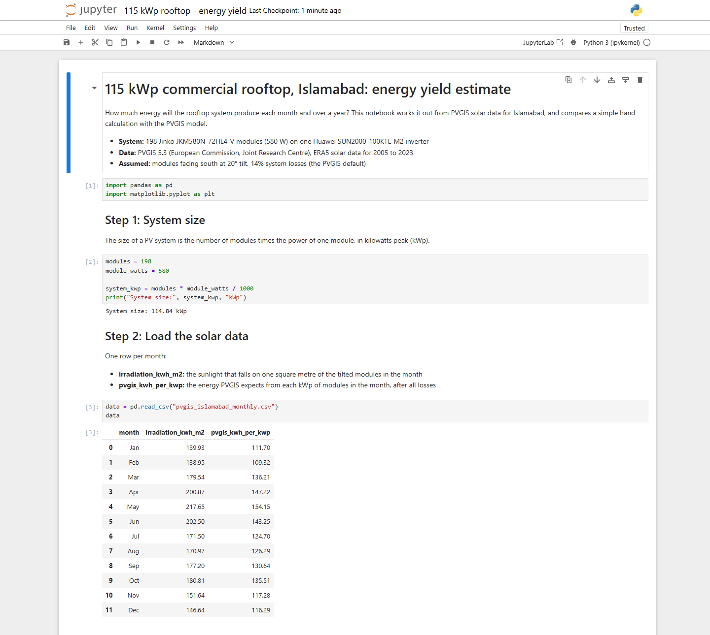
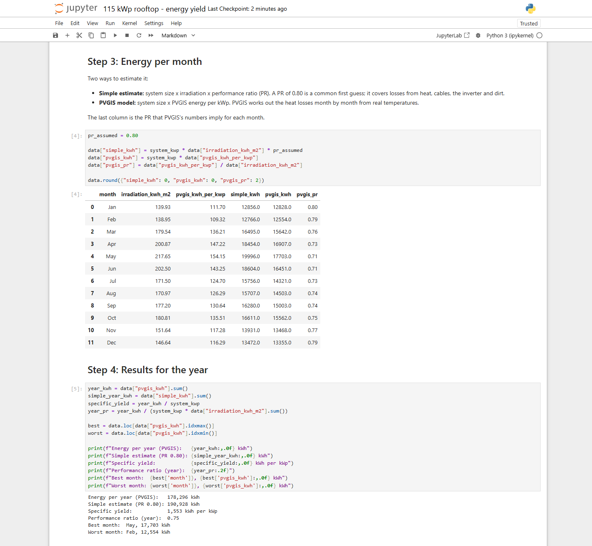
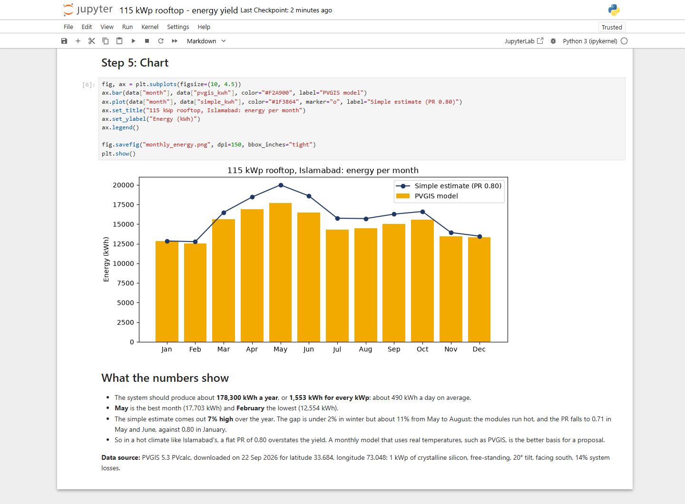
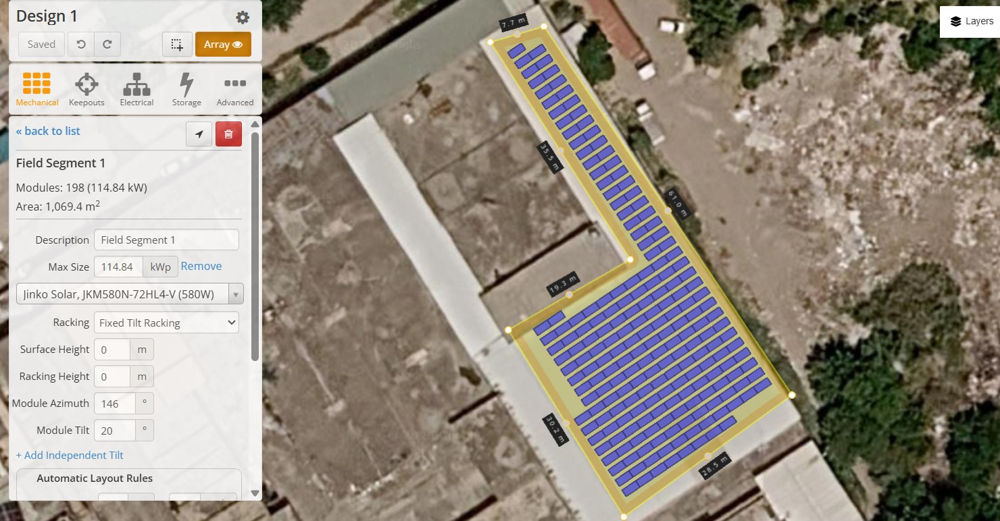
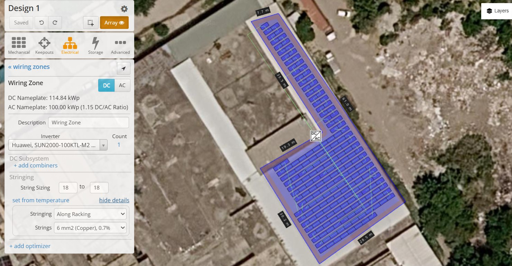
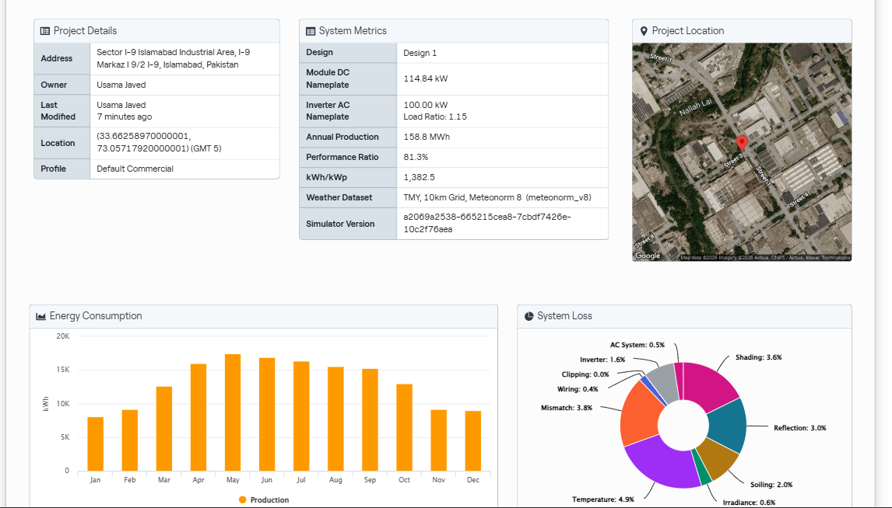
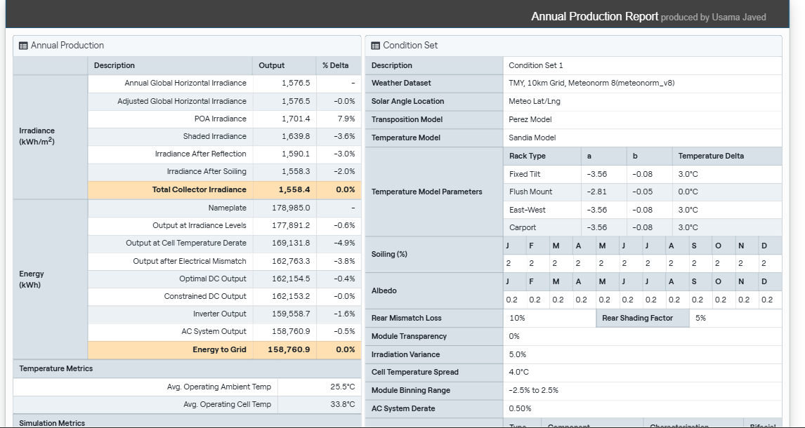

# 115 kWp Commercial Rooftop Solar PV: Energy Yield Model in Python and HelioScope

Live on portfolio: **[usamajaved.ie](https://usamajaved.ie/roles/energy-analytics)**

Energy yield estimate and simulation for a 115 kWp commercial rooftop PV system in Islamabad: **198 Jinko 580 W modules** (`JKM580N-72HL4-V`) giving **114.84 kWp**, wired in **11 strings of 18** into one **Huawei SUN2000-100KTL-M2** inverter.

---

## 1. Python Energy Yield Model (`115-kWp-rooftop-energy-yield.ipynb`)

A Jupyter notebook that estimates how much energy the 115 kWp rooftop in Islamabad will produce each month and over a year. It takes the system size from the bill of materials, reads PVGIS solar data for the site (`pvgis_islamabad_monthly.csv`, monthly averages for 2005 to 2023), and compares a simple flat-PR estimate (`system size x irradiation x 0.80`) with the PVGIS model.

### Key Findings

- **Annual production (PVGIS ERA5)**: **178,296 kWh a year**, or **1,553 kWh per kWp**, at a yearly performance ratio of **0.75**.
- **Best and lowest months**: May is the highest month (**17,703 kWh**) and February is the lowest (**12,554 kWh**).
- **Why the flat 0.80 PR estimate overstates yield by 7%**: from May to August the modules run hot and the performance ratio drops to about **0.71** (an 11% gap in the hot months), so a flat 0.80 overstates the yield in Islamabad's climate.
- Written in Python with `pandas` and `matplotlib`; the 20 deg south-facing tilt and 14% system losses are assumptions.





---

## 2. HelioScope Roof Layout and Simulation

The same 115 kWp system designed in HelioScope on a typical industrial roof in Islamabad's I-9 area: 198 Jinko 580 W modules on fixed-tilt racking at 20 deg, wired in 11 strings of 18 into one Huawei SUN2000-100KTL-M2 inverter (DC/AC ratio 1.15). HelioScope checked the strings against Islamabad temperatures: **998 V** on the coldest morning, inside the inverter's **1,100 V** limit.

- **Orientation trade-off**: the rows follow the building at an azimuth of **146 deg** (34 deg east of south) to fit all 198 modules; facing due south fits only 163 modules. The turn off south costs about 2% of yield per kWp and buys 35 more modules.
- **Simulation results (Meteonorm weather data)**: **158.8 MWh a year**, or **1,382.5 kWh per kWp** at a performance ratio of **81.3%**. That is about 9% below the PVGIS figure for the same orientation, mainly because Meteonorm has 14% less sunshine for Islamabad (`1,576.5 kWh/m2` GHI) than PVGIS's ERA5 data (`1,832.9 kWh/m2`). It is a sample design using HelioScope's default loss settings.






---

## Running the Notebook

```bash
pip install -r requirements.txt
jupyter notebook 115-kWp-rooftop-energy-yield.ipynb
```
